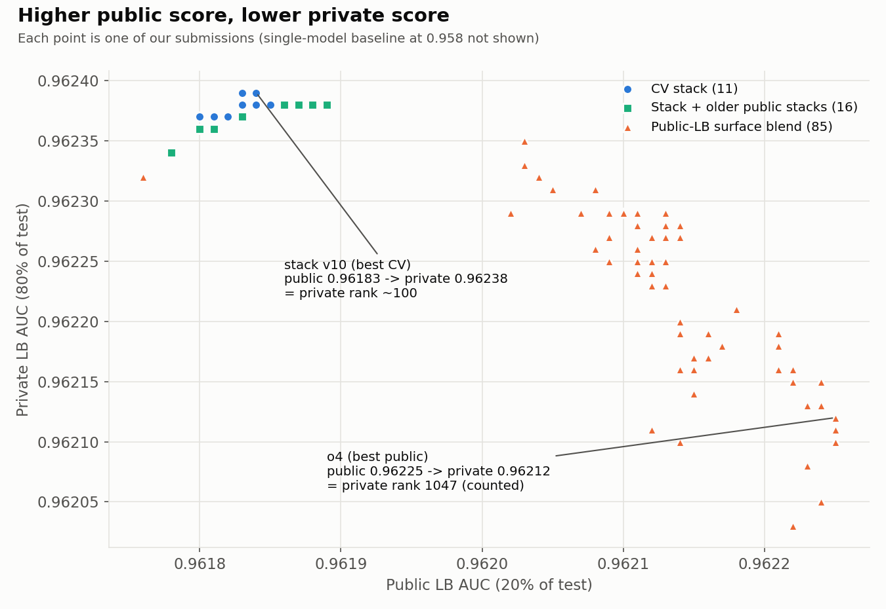
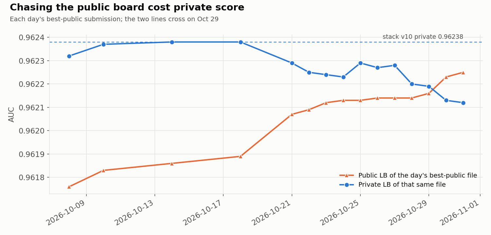
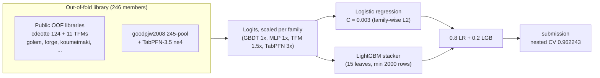
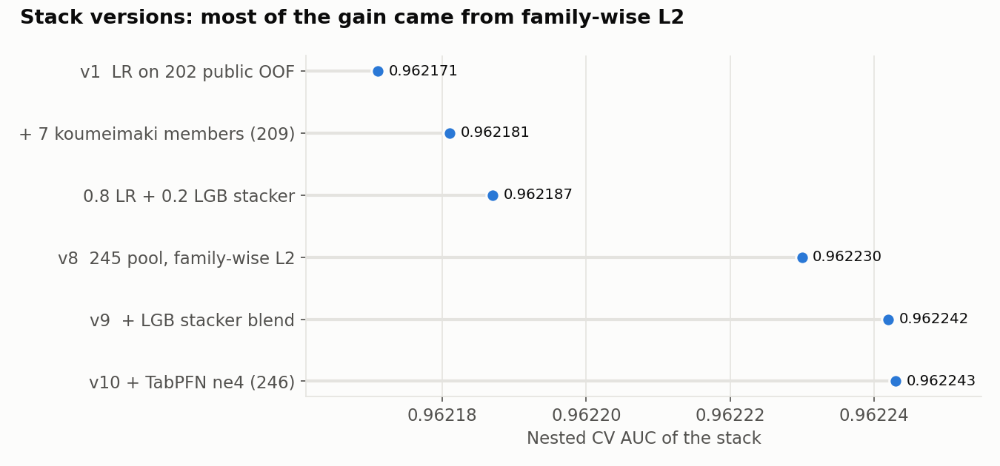
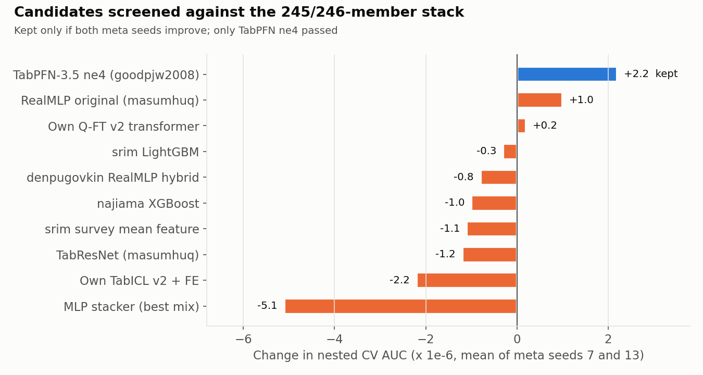

# Predicting Airline Satisfaction — Kaggle Playground S6E10

A 246-member stacked ensemble, plus a post-mortem on what happens when you chase the public leaderboard.

| | |
|---|---|
| Competition | [Playground Series S6E10](https://www.kaggle.com/competitions/playground-series-s6e10) |
| Task / metric | Binary classification (passenger satisfied?) / ROC-AUC |
| Data | 699,635 train rows, 299,844 test rows, 21 features (synthetic, generated from the [original airline survey](https://www.kaggle.com/datasets/teejmahal20/airline-passenger-satisfaction)) |
| Teams | 3,747 |
| Best honest model | Stack v10: **nested CV 0.962243**, private LB **0.96238** (equal to rank ~100) |
| Counted final | Public-LB blend `o4`: public 0.96225, private 0.96212, **rank 1047** |

---

## TL;DR

* The **nested-CV stack was the right answer.** Every honest stack scored 0.96237–0.96238 on the private board.
* From Oct 21 onward we submitted **85 public-LB "surface" blends**. These are rank blends of public files tuned to the public digits. They raised the public score from 0.96183 to 0.96225, but **lost ~0.00025 on private**.
* The two final picks did not include stack v10. The counted file was a surface blend, so the team finished at rank 1047. Stack v10 alone would have placed around **rank 100**.





---

## How the model works



* **Members.** All public OOF libraries share `StratifiedKFold(5, shuffle=True, random_state=42)`, so they stack without leakage. Pool sources are listed in each stacking script's `kernel-metadata.json`.
* **Family-wise L2.** Multiplying each model family's logits by a constant, before one L2-penalised logistic regression, gives each family its own effective penalty. Moving to the 245-member pool with family-wise L2 was the single biggest step (+4.3e-5 nested CV; the pool and the regularisation changed together).
* **Nested CV.** Every stacker is evaluated out-of-fold on meta folds with seeds 7 **and** 13. A change is kept only if *both* seeds improve.



### What did not help

Ten candidate members and stackers were screened after v10. Only one passed the both-seeds rule.



Also measured and dropped (details in [docs/JOURNAL.md](docs/JOURNAL.md)):

* Own GPU members: XGBoost with nested target encoding, TabM, kNN, TabICL v2 + feature engineering, and a Q-FT v2 order-free transformer (single OOF 0.9611, added +0.2e-6).
* Original-data "parent row" labels, near-duplicate "FD-twin" labels, and residual models on top of the stack.
* Adversarial validation (train vs test AUC 0.498, no shift), and an MLP stacker with or without raw features.

---

## Final scores

| File | What it is | Nested CV | Public | Private |
|---|---|---|---|---|
| `h5_v10_90_qft10` | v10 + 10% own Q-FT | – | 0.96183 | **0.96239** |
| stack v10 | 246 members, 0.8 LR + 0.2 LGB | 0.962243 | 0.96183 | **0.96238** |
| stack v8 | family-wise L2 only | 0.962230 | 0.96186 | 0.96238 |
| `f1_mean5_213` | mean of five public 0.96213 files | – | 0.96213 | 0.96223 |
| `n1_tk223` | public 0.96223 file as-is | – | 0.96223 | 0.96213 |
| `o4_E50_S50` (counted) | mean of two top public files | – | **0.96225** | 0.96212 |
| Q-FT v2 alone | own transformer, single model | 0.961116 | 0.96101 | 0.96165 |

The scores of all 116 submissions are in [`results/submissions_scores.csv`](results/submissions_scores.csv).

## Lessons

1. **When public LB and nested CV disagree, trust CV.** The public board is 20% of the test set (~60k rows). On it, near-identical files differ by ±2e-5 by chance.
2. **Files built by fitting public scores do not transfer.** Our public gain of +0.00042 became a private loss of −0.00026.
3. **Check both "final" ticks on the Submissions page before the deadline.**

---

## Repository layout

```
src/
  stacking/            Kaggle CPU kernels, one folder per stack version
    v1_lr_public_loaders/   LR stack on 202 public OOFs
    v8_familywise_l2/       245 pool + family-wise L2
    v9_famreg_lgb/          + LightGBM stacker blend
    v10_candidates/         v10 + candidate screening (both-seeds rule)
    v11_candidate_screen/   later candidate screens (srim, Q-FT, denpugovkin, masumhuq)
    v12_mlp_stacker/        MLP stackers on logits / logits + raw features
  members/             own GPU members (XGBoost + TE, TabM, kNN)
  tabicl_fe/           TabICL v2 + engineered features (two GPU kernels, folds 0-2 and 3-4)
  qft_transformer/     Q-FT v2: order-free transformer with replaced-token-detection pretraining
  blending/            rank-blend helper used for public-LB files
  analysis/            make_figures.py (README charts)
results/
  submissions_scores.csv   public and private scores of all 116 submissions
  figures/                 charts used above
docs/
  JOURNAL.md          day-by-day log of every experiment, number and decision
data/                 (not in git) competition + original data, see data/README.md
artifacts/            (not in git) OOF / test predictions and submission files
```

## Reproduce

```bash
pip install -r requirements.txt
kaggle competitions download -c playground-series-s6e10 -p data && unzip data/playground-series-s6e10.zip -d data
kaggle kernels push -p src/stacking/v10_candidates      # runs the v10 stack on Kaggle (CPU, ~25 min)
python src/analysis/make_figures.py                      # rebuilds the charts from results/
```

The stacking kernels read the public OOF datasets listed in their `kernel-metadata.json`. Kaggle attaches these datasets automatically when the kernel is pushed.

## Credits

The stack is built on public out-of-fold libraries shared by Chris Deotte, goodpjw2008, dariushafshar, koumeimaki, amanatar, sadamtorres, kagankoral and others in the competition. The family-wise L2 idea comes from ewtherka and goodpjw2008. Thank you to everyone who published OOF predictions.
